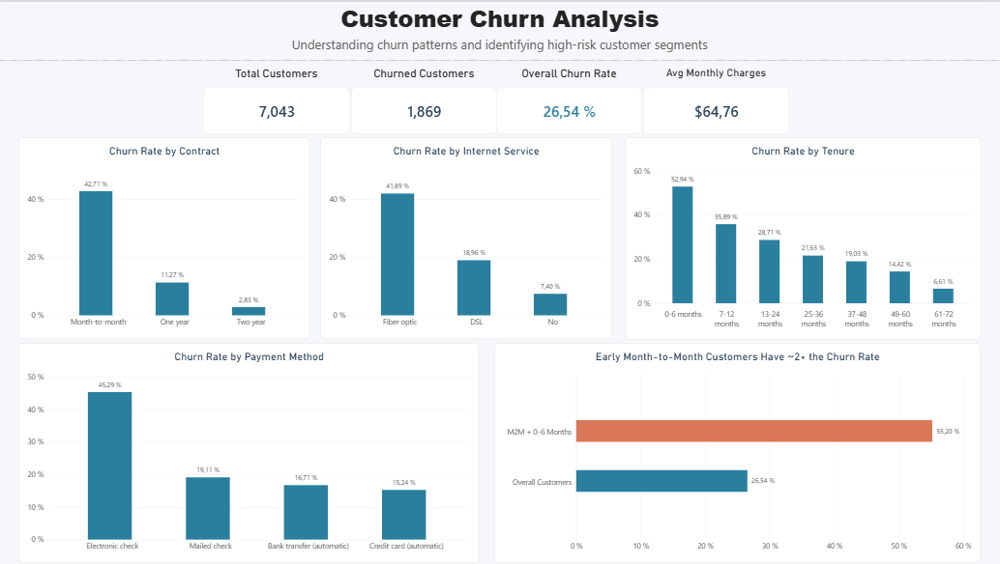

# customer-churn-analysis
Customer churn analysis using SQL Server and Power BI to identify high-risk customer segments and support retention decisions.

## Project Overview

Customer churn is a major challenge for subscription-based businesses because losing customers can reduce recurring revenue and increase customer acquisition costs.

This project analyzes customer churn using SQL Server and Power BI to identify customer segments with higher churn rates, explore patterns associated with customer attrition, and develop data-driven recommendations to support customer retention.

The analysis covers data quality validation, exploratory SQL analysis, customer segmentation, and an interactive Power BI dashboard.

**Project objective:** Identify high-risk customer segments and provide actionable insights that can help a business prioritize its customer retention efforts.

## Power BI Dashboard

An interactive Power BI dashboard was developed to summarize the customer churn analysis and make the key findings easier to explore.


## Business Questions

This analysis investigates the following questions:

1. What is the overall customer churn rate?
2. Which customer segments have the highest churn rates based on customer characteristics, services, and contract types?
3. How does customer tenure relate to churn?
4. How do monthly charges relate to customer churn?
5. Which combinations of customer characteristics identify particularly high-risk segments?
6. What actionable recommendations can help the business prioritize customer retention efforts?

## Tools & Technologies

- **SQL Server & SQL Server Management Studio (SSMS):** Data quality validation, data exploration, and churn analysis.
- **Power BI:** Interactive dashboard development and data visualization.
- **GitHub:** Project documentation, version control, and portfolio presentation.

## Data Preparation & Quality Checks

Before performing the churn analysis, data quality checks were conducted using SQL Server to assess the reliability and consistency of the dataset.

The checks included:

- **Duplicate records:** Verified customer records for duplicates; no duplicate customer IDs were found.
- **Missing values:** Checked for missing and blank values in relevant columns and investigated missing 'TotalCharges' values in the raw data.
- **Data consistency:** Validated categorical values and checked logical consistency across relevant fields.
- **Numeric validation:** Examined the ranges of key numeric variables, including tenure, monthly charges, and total charges.
- **Data cleaning:** Created and validated a cleaned table, 'Customer_Clean', for use in the subsequent analysis.

The cleaned dataset contained **7,043 customer records** and was used as the basis for the SQL analysis and Power BI dashboard.

## Key Findings

The analysis of 7,043 customer records identified the following churn patterns:

- **Overall churn:** 26.54% of customers had churned, representing 1,869 customers.
- **Contract type:** Month-to-month customers had a churn rate of 42.71%, compared with 11.27% for one-year contracts and 2.83% for two-year contracts.
- **Customer tenure:** Customers with 0–6 months of tenure had a churn rate of 52.94%, with churn rates generally declining as tenure increased.
- **Internet service:** Fiber optic customers had a churn rate of 41.89%, compared with 18.96% for DSL customers and 7.40% for customers without internet service.
- **Payment method:** Customers using electronic checks had a churn rate of 45.29%.
- **High-risk segment > Contract type and tenure:** Month-to-month customers with 0–6 months of tenure had a churn rate of **55.20%**: **780 out of 1,413 customers** churned.
- **High-risk segment > Contract type and internet service:** Month-to-month customers with Fiber optic internet had a churn rate of **54.61%** among 2,128 customers, with 1,162 customers churning.

These findings highlight customer groups that may warrant closer monitoring and targeted retention efforts. The observed relationships identify patterns in the dataset but do not establish that any individual characteristic causes churn.

## Business Recommendations

Based on the observed churn patterns, the following actions could help prioritize customer retention efforts:

1. **Prioritize early-tenure customers:** Focus on month-to-month customers in their first six months with proactive onboarding, early check-ins, and timely support before they decide to leave.

2. **Investigate high-risk customer segments:** Examine month-to-month customers with Fiber optic internet to understand their reasons for leaving and identify opportunities to improve their experience.

3. **Encourage longer-term contracts:** Test targeted incentives or explain the benefits of one-year and two-year contracts to eligible month-to-month customers, while monitoring conversion and retention outcomes.

4. **Review the electronic-check payment experience:** Investigate whether payment friction, billing concerns, or other factors may contribute to the higher churn observed among electronic-check users.

5. **Measure retention outcomes:** Track churn rates across these segments over time and evaluate whether targeted retention initiatives improve customer retention.

These recommendations are hypotheses for business action, not proven solutions. Their effectiveness should be evaluated using customer feedback, further investigation, and measured retention outcomes.

## Project Structure

```text
customer-churn-analysis/
├── README.md
├── sql/
│   ├── 01_data_quality.sql
│   └── 02_churn_analysis.sql
├── powerbi/
│   └── customer_churn_dashboard.pbix
└── Images/
    └── churn_dashboard.png
```
